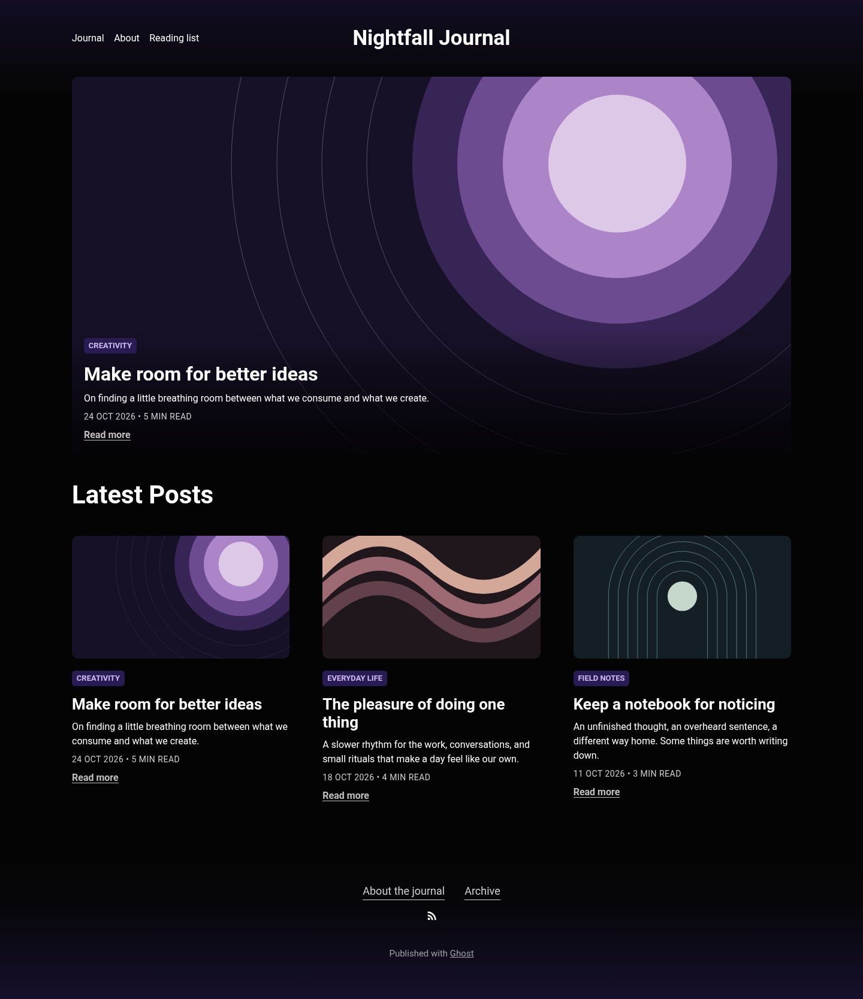
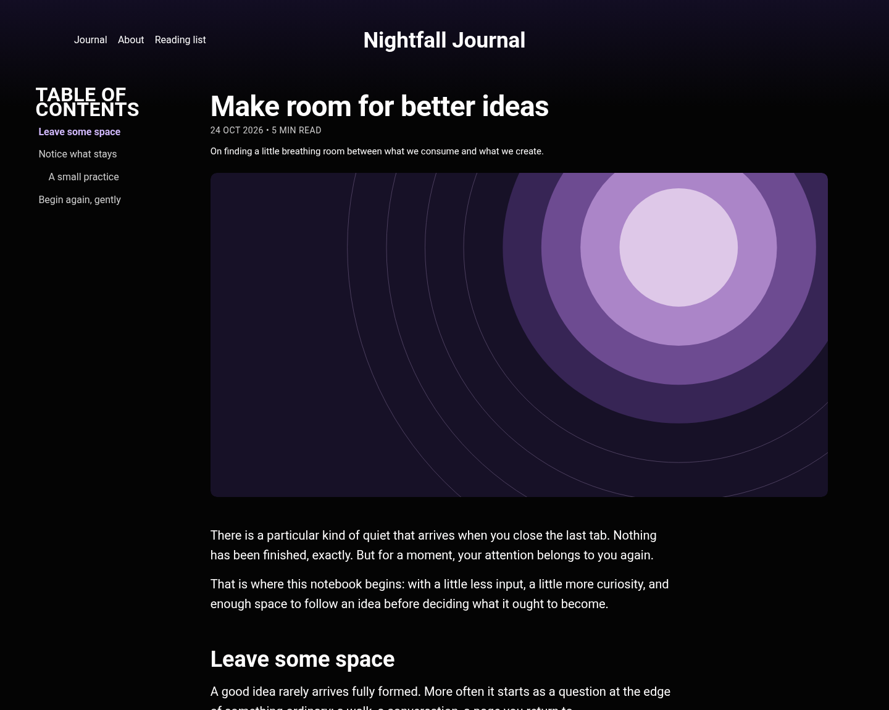
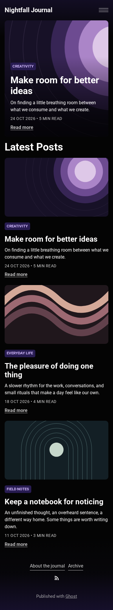

# Purple Haze

A dark Ghost theme built for long reads, with purple accents and a sticky table of contents that highlights the reader’s current section as they scroll.

[Live example](https://piotrowskiadam.pl/) · [Download a release](https://github.com/piotrowskiadam/Purple-Haze-Ghost-Theme/releases) · [Report a problem](https://github.com/piotrowskiadam/Purple-Haze-Ghost-Theme/issues)



Screenshots show **Nightfall Journal**, a fictional publication rendered locally from the **v1.5.1** theme templates. Article titles, author names, and artwork are sample content. These previews use a lightweight template fixture, rather than a running Ghost installation.

## A table of contents that follows the reader

Long articles should be easy to explore. On wider desktop screens, Purple Haze keeps the table of contents alongside the article as you scroll, **automatically highlighting the heading of the section you’re reading**. Readers can see where they are at a glance and click any heading to jump to another section.

The outline is generated automatically from your article’s H2 and H3 headings, with subsections indented. There’s no outline to maintain by hand. It stays out of the way on smaller screens and is hidden when an article has no headings.



## Features

- **Sticky table of contents with active-section highlighting**, generated automatically from article headings.
- Dark background, purple accents, and configurable navigation and link colors.
- Responsive post grid, tag archives, author archives, and an optional featured-post spotlight.
- Syntax highlighting for JavaScript, CSS, HTML, Bash, and JSON.
- Keyboard-accessible image zoom and horizontally scrollable tables in articles.
- Infinite scrolling with ordinary pagination links as a fallback.
- Ghost search, member signup through Portal, subscription forms, and native comments.
- English and Polish theme translations, including reading-time labels.
- An optional **About** template for static pages.

<details>
<summary>Mobile screenshot</summary>



</details>

## Installation

1. Download **purple-haze.zip** from a [GitHub release](https://github.com/piotrowskiadam/Purple-Haze-Ghost-Theme/releases). Choose the attached theme ZIP, rather than GitHub’s automatically generated source archives.
2. Open your publication’s Ghost Admin, go to **Settings → Site → Theme**, and choose **Change theme → Upload theme**. Labels can vary between Ghost versions.
3. Upload the ZIP and activate Purple Haze.
4. Review your navigation, logo, colors, and membership settings.

To upgrade an existing installation, keep a copy of your previous theme ZIP and note any edits you made directly to theme files. Upload the new ZIP through the same screen, then check the homepage, an article, archives, and mobile menu. Restore the previous ZIP if needed. Publication content is managed by Ghost separately from the theme.

**Compatibility:** theme rules are checked with GScan for Ghost 5 and 6. Ghost 6 currently reports two social-helper deprecation warnings; the older helpers are retained for Ghost 5 compatibility. CI runs Chromium, Firefox, and WebKit fixture checks. Separate Ghost 6.72.0 staging checks cover native pages, search, Portal, comments, and member-only content; paid checkout and the full branded-browser matrix remain manual. See the [maintenance review](docs/MAINTENANCE.md) for validation scope and remaining work.

## Configuration

Ghost’s built-in **Accent color** controls the primary accent. The CSS fallback is `#281C52`; an accent color already saved in Ghost takes precedence.

| Theme setting | Default | Used for |
| --- | --- | --- |
| Secondary accent color | `#D0B8FB` | Links, tag text, captions, and hover states |
| Featured overlay color | `#000000` | Gradient over the featured spotlight image |
| Navigation text color | `#FFFFFF` | Header navigation and site title |

The homepage spotlights the newest featured post on its first page. The chronological feed includes **all** posts, including featured posts, so archive pagination remains complete. A spotlighted post can therefore also appear in the feed.

Set the publication language to **English** or **Polish** to use the included translations. The theme loads Roboto from Google Fonts. Ghost provides the search, Portal, editor-card assets, and comments integrations; availability depends on your publication settings. Select **About** in a page’s template settings to use `custom-about.hbs`.

The `members/` templates are retained for installations with custom membership routes. A normal installation uses Ghost Portal and does not need custom routes. Test any existing membership routes and paid checkout separately before upgrading.

## Development

Use Node **22.17+ within Node 22**, or Node **24**, and npm. Node is needed to build and validate the theme; readers do not install it.

```bash
npm ci
npm run dev
```

Run the theme inside a [local Ghost installation](https://docs.ghost.org/install/local/). For example, symlink this checkout into that installation’s `content/themes/purple-haze` directory, restart Ghost, and select the theme in Admin. `npm run dev` watches source files, rebuilds `assets/built/`, and runs LiveReload. Production Ghost caches templates, so restart it after template changes when developing in production mode.

```bash
npm run build          # Production CSS and JavaScript
npm test               # Build and run Ghost 5 + Ghost 6 compatibility checks
npm run test:release   # Verify release publication safeguards
npx playwright install chromium firefox webkit
npm run test:browser   # Chromium, Firefox, and WebKit regression checks
npm run test:html      # Rendered HTML and landmark validation
npm run screenshots    # Regenerate the fictional publication previews
npm run zip            # Build purple-haze.zip
npm run check:zip      # Validate the actual upload archive
```

Edit `assets/css/`, `assets/js/`, and `.hbs` templates. The compiled files in `assets/built/` are tracked and should be rebuilt with source changes. npm’s `package-lock.json` is the dependency lockfile.

| Path | Purpose |
| --- | --- |
| `default.hbs` | Shared document, header, and footer |
| `index.hbs`, `partials/card.hbs` | Post feed and featured spotlight |
| `post.hbs`, `page.hbs`, `custom-about.hbs` | Articles and static pages |
| `tag.hbs`, `author.hbs` | Archive pages |
| `locales/` | Theme translations |
| `tests/` | Browser fixtures and interaction regressions |

For native Ghost integration checks, prepare a separate test publication as described in the [submission audit](docs/SUBMISSION-AUDIT.md), then run `GHOST_TEST_URL=http://127.0.0.1:2369 npm run test:ghost`.

[Release process](docs/RELEASING.md) · [Marketplace preparation](docs/MARKETPLACE.md) · [Submission audit](docs/SUBMISSION-AUDIT.md) · [Contributor notes](AI_AGENT_NOTES.md)

## Support and license

For bugs, [open an issue](https://github.com/piotrowskiadam/Purple-Haze-Ghost-Theme/issues) with your Ghost version, theme version, browser, steps to reproduce, and a screenshot where useful. Remove account details and private content from reports. Community support is provided through GitHub issues; no response-time guarantee is offered.

Created by Adam Piotrowski, based on [Ghost Starter](https://github.com/TryGhost/Starter). Released under the [MIT license](LICENSE), with the original Ghost Foundation attribution retained.
